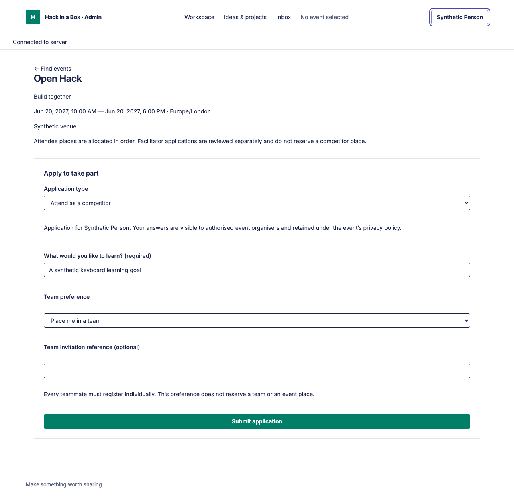
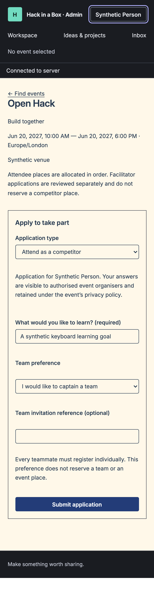
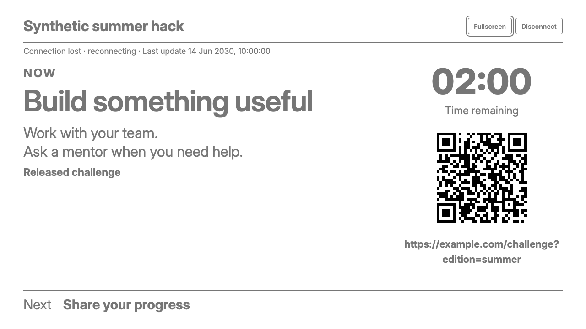

# Fleet foundations — DS-01 / #230

The accepted design and its original review artifacts are retained under
[the Fleet reference](../../design/fleet-reference/README.md); all manifest hashes
were checked and all 100 qualities have unique applicability/owner rows. This
foundation implements tokens/base rules, not the later route/composition rebuild.
The screenshots show actual production components with synthetic route fixtures;
remaining panel composition is owned by #232/#234 and the domain migration tickets.

## Changed behavior and local proof

Before this change, defaults used forest/cream/copper, system typography, rounded
panels, 8px controls and fixed component metrics. The new defaults use Fleet-derived
navy/white/teal, self-hosted Inter, a small rem-based type scale, flat surfaces,
4px controls, shared density/focus/motion tokens and scoped mode overrides. Persisted
valid event palettes remain authoritative; these tests deliberately include old,
custom-light, custom-dark and threshold-contrast branding.

- Web lint, all 60 unit tests and both portal production builds: PASS.
- Focused admin Playwright: 24 cases PASS across desktop/mobile.
- Focused participant/display Playwright: 34 cases PASS across desktop/mobile,
  including actual QR decoding, reconnect/revocation, maximum legal stream frame,
  projector sizing and branded controls.
- Computed-browser coverage includes six palette/system combinations, 4.5:1 text
  and action contrast, 3:1 field/focus contrast, native validation, draft privacy,
  scoped portals, explicit light/dark overrides and reduced motion. Local font
  loading is proven without third-party font requests.
- Existing branding save/conflict/event-isolation and display safety assertions
  remain; only expected default colours/radii/ring metrics change.

The first runs correctly rejected stale default-colour/radius expectations. A
public test run from the repository root also could not find its cwd-relative SSE
fixture; running the established suite from `web` resolved that harness error.
The room-focus diagnosis then found `:focus-visible=false`, `outline-style=none`
and the browser's default 3px width: the old assertion had not proved a visible
ring. The updated test enters keyboard modality and checks focus-visible, solid
2px outline and actual contrast. No product timing/permissions were relaxed.

Commands used: existing `npm run lint`, `npm test`, `npm run build` from `web`;
focused Playwright against each freshly built portal on separate temporary ports,
with the desktop/iPhone Chromium projects. Full current-head CI is the merge gate.
The cross-browser/manual accessibility audit remains #122.

## Visual inspection

These are token/cascade/interaction evidence, not a claim that all existing pages
already have their final Fleet composition or that the interactive guide is built.
